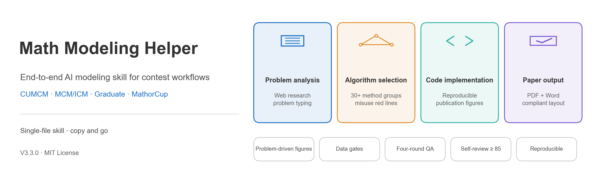
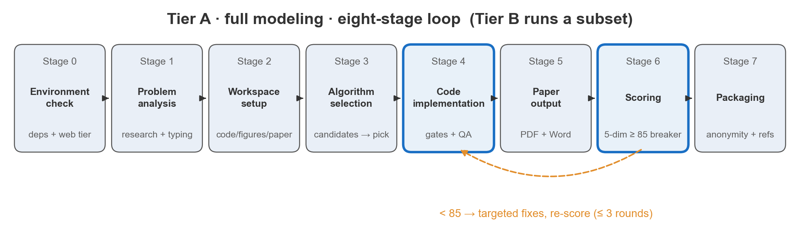
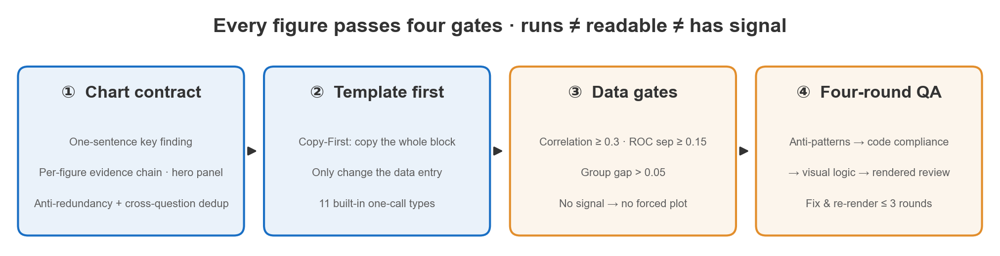
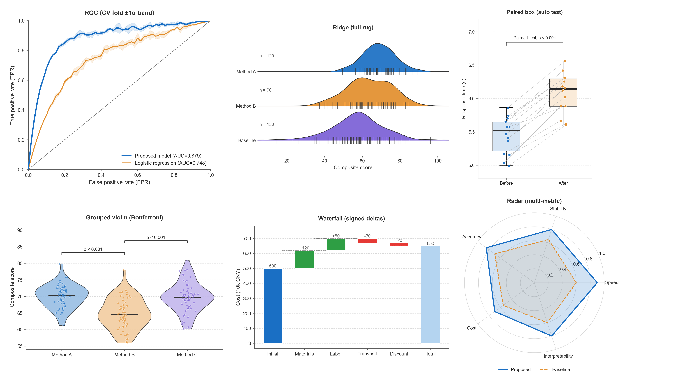

<div align="center">



# Math Modeling Helper

**Math modeling contest assistant · V3.3.0**

Problem analysis · Algorithm selection · Code implementation · Paper polishing — an end-to-end AI modeling skill from problem input to final paper


[中文](https://github.com/Escap1ng/math-modeling-skill/blob/main/README.md) | **English**

[Overview](#overview) · [Highlights](#highlights) · [Usage](#usage) · [Quick Start](#quick-start) · [Workflow](#workflow) · [Environment](#environment) · [Algorithm Library](#algorithm-library) · [Paper & Formatting Standards](#paper--formatting-standards) · [Visualization Standards](#visualization-standards) · [Scoring System](#scoring-system) · [Structure & Files](#structure--files) · [Changelog](#changelog) · [License](#license)

</div>

---

## Overview

An end-to-end AI skill for mathematical modeling contests: **problem understanding → model construction → algorithm implementation → paper output → quality self-assessment**. The skill itself is a single Markdown file (`SKILL.md`) — installed by copying; the finalized paper ships as both PDF and Word with natively editable equations, with no manual re-typesetting.

> **Competitions** — China Undergraduate Mathematical Contest in Modeling (CUMCM, 高教社杯), MCM/ICM (Mathematical Contest in Modeling / Interdisciplinary Contest in Modeling), China Graduate Mathematical Contest in Modeling (“华为杯”), MathorCup (大学生数学建模挑战赛), the National Statistical Modeling Contest for College Students (全国大学生统计建模大赛), and the Asia-Pacific Mathematical Contest in Modeling for College Students (APMCM), among others. Defaults follow the CUMCM rules.

> **Disclaimer**: All content generated by this tool is for learning reference only. Users must verify accuracy themselves and comply with contest academic integrity rules. Formatting follows the latest official regulations.

---

## Highlights

| Highlight | Description |
| :--- | :--- |
| End-to-end automation | Eight stages (0–7) in one run — see [Workflow](#workflow) |
| Tiered workflow | Full modeling runs all stages; algorithm advice, per-question code, and paper polishing run only the needed subset — see [Workflow](#workflow) |
| Single-file skill | The whole skill is one `SKILL.md` — no plugins, no scripts; copy and go, easy to customize |
| Dual-format paper | PDF and Word in one run — most comparable setups deliver only a single Markdown or PDF alone |
| Curated algorithm library | High-frequency and frontier methods, incl. time-series foundation models and uncertainty quantification — see [Algorithm Library](#algorithm-library) |
| Misuse guards & baselines | 11 algorithm-misuse red lines + per-type minimum baselines + tuning/compute budget — see [Algorithm Library](#algorithm-library) |
| Publication-grade figures | Nature three-role palette and a unified style module — see [Visualization Standards](#visualization-standards) |
| Award-level formatting | Award-paper layout with anonymity compliance — see [Paper & Formatting Standards](#paper--formatting-standards) |
| Traceable research | Web research across background, methods, open-source code, and references, with a search log and a citation verification ledger |
| Quality loop | Five-dimension 0–100 self-scoring with a circuit breaker — see [Scoring System](#scoring-system) |
| Reproducible delivery | Global random seed + version-pinned requirements.txt + pre-packaging anonymity check and figure-reference cross-check — see [Workflow](#workflow) |

---

## Usage

Copy the root `SKILL.md` into your agent's skills directory (the exact path varies by tool — see its docs; the folder name must match `name: math-modeling-helper` in the `SKILL.md` front matter, e.g. `~/.claude/skills/math-modeling-helper/SKILL.md`). The dependency list lives in [Environment](#environment).

---

## Quick Start

Once the skill is installed in your AI IDE, finish a modeling task in three steps:

```
1. Upload the problem files (PDF / Excel / CSV / TSV / TXT) or paste the problem content
 ↓
2. The skill runs the eight-stage workflow (Stages 0–7) automatically (see Workflow below)
 ↓
3. Get the complete project tree: code/ + figures/ + paper/ (structure below)
```

Need only one part? State the scope and it runs as a single service — no workspace setup, no paper, no scoring:

| Example request | What actually runs |
| :--- | :--- |
| "Which algorithm fits sub-question 2? Just the reasoning." | Web research → candidate comparison → selection verdict with rationale |
| "Write code for sub-question 1 only, no paper yet." | Check only the libs it needs → create code/figures only → runnable code and figures |
| "Polish this draft; don't touch the models or numbers." | Revise per writing standards → run the checklist → deliver the revision with a change log |

---

## Workflow



Classify before executing: **Tier A · full modeling** (default, from problem input to final paper) runs the eight stages below (Stages 0–7); **Tier B · single service** (algorithm advice / per-question code / paper polishing) runs only the matching subset — no forced full environment check, workspace setup, or paper scoring (rules and subsets: see the "工作流分级" section in SKILL.md).

```
Stage 0 env check → Stage 1 problem analysis → Stage 2 workspace setup → Stage 3 algorithm selection
 ↓
Final output ← Stage 7 packaging & anonymity check ← Stage 6 score ≥ 85? → Stage 5 paper output ← Stage 4 code implementation
 ↓ no
 Targeted fixes → Re-score (≤ 3 rounds)
```

| Stage | Work |
| :--- | :--- |
| Tiering · Service level | Tier A runs the full workflow; Tier B runs the matching subset (advice / per-question code / polishing); default A when unclear, B when the user says "only / just" |
| Stage 0 · Environment check | Verify xelatex / pandoc / Python deps and plotting libraries, and determine the web-research capability tier; auto-install what is missing; output a status report |
| Stage 1 · Problem analysis | Web research on the problem background and on existing public solutions; classify the problem (optimization / prediction / evaluation / classification / ODE); map data, constraints, and output targets per sub-question |
| Stage 2 · Workspace setup | Create an `answer/` tree per problem with unified code / figures / paper locations |
| Stage 3 · Algorithm selection | Generate 2–3 candidates per sub-question, supplement them with web research on recent methods and strong papers, and pick by accuracy, complexity, robustness, interpretability, and feasibility; fitness over fancy |
| Stage 4 · Code implementation | Check mature libraries and high-star open-source implementations first (license vetted); then complete runnable code, vectorized numpy, publication-grade figures via the unified style module |
| Stage 5 · Paper output | xelatex for PDF, pandoc for Word (OMML formulas); both formats delivered together |
| Stage 6 · Scoring & refinement | Five-dimension 0–100 self-scoring; below the gate, fix and re-score (see [Scoring System](#scoring-system)) |
| Stage 7 · Packaging & anonymity check | Anonymity scan of text / file names / figures / metadata, bidirectional figure-reference check, tmp cleanup, reproducibility spot-run, requirements.txt and support-materials zip |

---

## Environment

The dependencies below are auto-checked in Stage 0; missing ones are installed automatically or reported with install guidance.

| Dependency | Purpose | Installation |
| :--- | :--- | :--- |
| TeX Live / MiKTeX (xelatex) | Compile LaTeX to PDF | Official installer |
| pandoc | LaTeX → Word, formulas converted to OMML | `winget install pandoc` or official download |
| Python 3.8+ | Numerical computing, ML, and plotting | Official installer |
| python-docx / PyMuPDF / openpyxl / xlrd | Word layout fine-tuning, PDF & Excel data loading | `pip install python-docx pymupdf openpyxl xlrd` |
| numpy / pandas / scipy / matplotlib / seaborn | Numerical computing, optimization, plotting | `pip install` |
| pulp / cvxpy / scikit-learn / xgboost / networkx / statsmodels | Programming models, ML, graph theory, statistics (pick per problem) | `pip install` |
| graphviz / kaleido | Complex architecture diagrams / plotly static export (optional) | On demand |

Install the Python dependencies in one line (`xelatex` and `pandoc` are system-level installs — see the table above):

```bash
pip install numpy pandas scipy matplotlib seaborn openpyxl xlrd python-docx pymupdf pulp cvxpy scikit-learn xgboost networkx statsmodels
```

Check which packages are missing (silent when all are present):

```bash
python -c "import importlib.util as u; [print('MISSING:', m) for m in ['numpy','pandas','scipy','matplotlib','seaborn','openpyxl','xlrd','docx','fitz'] if u.find_spec(m) is None]"
```

Install per problem: `lightgbm` (gradient boosting), `ortools` (combinatorial optimization / assignment), `pymoo` (NSGA-II/III), `prophet` (time series), `PyWavelets` (wavelets; import name `pywt`), `timesfm[torch]` (TimesFM 3 time-series foundation model, Python>=3.10, non-commercial weights), `shap` (model explanation), `geopandas` / `folium` (geospatial & maps), `adjustText` (label placement); also on demand: `optuna` (hyperparameter search), `catboost`, `lmfit` (bounded fitting), `lifelines` (survival analysis), `filterpy` (Kalman), `EMD-signal` (EMD; import name `PyEMD`), `simpy` / `mesa` (simulation), `esda` / `pykrige` (spatial statistics), `jieba` (Chinese tokenization), `gplearn` / `pysr` (symbolic regression; PySR needs Julia), `dowhy` / `econml` (causal inference), `torch` / `deepxde` / `stable-baselines3`+`gymnasium` / `torch-geometric` (deep learning, PINN, RL, graph networks).

Stage 0 also probes web-research capability (keyword search and full-text retrieval of a given URL) and records the result in the environment report as available / partially available / unavailable; when unavailable, the fallback rules apply and no reference may be filled in from memory.

---

## Algorithm Library

| Category | Methods |
| :--- | :--- |
| Basic Numerical Methods | Bisection, Newton iteration, gradient descent, conjugate gradient, simplex, interior point<br>trapezoidal / Simpson integration, Gaussian elimination, LU decomposition, least-squares fitting<br>Lagrange / Newton / cubic spline interpolation |
| Classical Optimization | 0-1 integer programming, nonlinear programming, dynamic programming, branch and bound, LP, Hungarian algorithm<br>goal programming, transportation problem, QP, Lagrangian relaxation<br>game theory (zero-sum, Nash equilibrium, evolutionary games) |
| Heuristic Optimization | Genetic Algorithm (GA), Simulated Annealing (SA), Particle Swarm Optimization (PSO), Tabu Search (TS) |
| Graph Theory & Networks | Shortest path (Dijkstra / Floyd / Bellman-Ford), MST (Prim / Kruskal), max flow, min-cost max flow<br>TSP / VRP, bipartite matching, topological sort, CPM / PERT, Eulerian / Hamiltonian cycles |
| Swarm Intelligence | Differential Evolution (DE), Ant Colony (ACO), Grey Wolf (GWO), Whale Optimization (WOA), Artificial Bee Colony (ABC)<br>Sparrow Search (SSA), Dung Beetle (DBO), Golden Jackal (GJO), Beluga Whale (BWO) |
| Machine Learning & Deep Learning | XGBoost, SVM, Random Forest, LightGBM, CatBoost, KNN<br>Transformer, CNN, RNN / LSTM, autoencoders (AE / VAE), attention mechanisms<br>Reinforcement learning: DQN, PPO, SAC, TD3 |
| Statistics & Data Analysis | Hypothesis tests (Z / t / chi-square, ANOVA, Shapiro-Wilk), correlation (Spearman / Kendall)<br>regression & interpolation (RSM, GPR, ridge / Lasso, polynomial / stepwise)<br>dimensionality reduction & clustering (PCA, t-SNE, UMAP, K-means / DBSCAN, hierarchical, GMM)<br>time series (ARIMA, LSTM / GRU, Prophet, Holt-Winters, VAR)<br>small-sample forecasting (Grey GM(1,1), Markov chains, combined forecasting)<br>classification (Fisher discriminant, logistic regression, naive Bayes, decision trees)<br>statistical inference (MLE, EM algorithm, Bayesian estimation) |
| Anomaly Detection & Uncertainty | 3σ / IQR rules, Isolation Forest, LOF, DBSCAN noise points<br>bootstrap CIs (BCa), quantile regression & interval forecasts (empirical coverage required), Monte Carlo error propagation |
| Inverse Problems & Survival Analysis | Nonlinear least squares (LM / trust region), bounded fitting with parameter CIs, identifiability analysis<br>Kaplan–Meier curves, Cox proportional hazards (censored data) |
| Text & Spatial Analysis | Chinese tokenization + TF-IDF, LDA topic models, text classification & sentiment lexicons<br>Moran's I / LISA spatial autocorrelation, kriging, spatial weight matrices & spatial regression |
| Hyperparameter Search | Grid / random search, TPE & Bayesian optimization, early-stopping pruning (trial budget required up front) |
| Evaluation & Decision Making | TOPSIS (entropy-weight TOPSIS preferred), entropy weight, CRITIC, AHP<br>grey relational analysis, fuzzy comprehensive evaluation, DEA<br>expected-value decision, decision-tree analysis, cost-benefit analysis |
| Physics & Engineering | Kinematics, Lagrangian mechanics, finite element analysis, rigid-body dynamics<br>numerical ODE solvers (Euler, RK4, finite difference, SIR / SEIR, stability analysis)<br>Monte Carlo, discrete-event simulation, cellular automata, agent-based modeling, queuing theory |
| Signal Processing | FFT, wavelet transform, EMD, Kalman filter, Hilbert-Huang transform (HHT) |
| Frontier Methods | PINN, operator learning (DeepONet / FNO), digital twin<br>symbolic regression, explainable AI (SHAP / LIME), causal inference (DID, causal graphs)<br>multi-objective optimization (NSGA-II / III, MOEA/D), robust / Bayesian optimization, GNN / GAT, community detection (Louvain) |
| Time-Series Foundation Models | TimesFM 3.0 (zero-shot, native multivariate + covariates + quantiles; non-commercial weights, Apache-2.0 2.5 weights as fallback)<br>alternatives: Chronos-2, Moirai 2.0 (check weight license and capability boundaries before adoption) |

### Selection guards: misuse red lines and baselines

The library answers *what is available*; the three disciplines below answer *what not to misuse* and *what to compare against*. All three feed the quality checklist and the scoring rules.

**Algorithm-misuse red lines (11 rules, checked at selection time; any hit forces a change)**

| Category | Typical red lines |
| :--- | :--- |
| Capacity vs. data | Deep learning / RL on small samples; expensive methods used as the main model without a feasibility run |
| Embedding & split misuse | Clustering or regression on t-SNE / UMAP coordinates (visualization only); random splits on time series causing leakage |
| Missing checks | AHP without the consistency ratio; GM(1,1) without ratio and posterior-variance tests; K-means without a basis for k |
| Wrong conventions | Entropy / CRITIC weights without unifying indicator direction; accuracy alone on imbalanced classes; interval forecasts without empirical coverage |
| Causal overreach | Writing "causes / drives" from a significant correlation, with no identification strategy or refutation test |

**Minimum baselines per problem type** (an improvement percentage without a baseline does not count)

| Type | Required baselines |
| :--- | :--- |
| Forecasting | Naive (last value) + seasonal naive, plus ARIMA / exponential smoothing or GM(1,1) |
| Optimization | Greedy / rule-based feasible solution + LP relaxation or exact lower bound, reporting the optimality gap |
| Classification | Majority-class baseline + logistic regression (accuracy alone banned when imbalanced) |
| Evaluation / ranking | Equal-weight TOPSIS + one alternative weighting, compared by rank correlation and weight-perturbation stability |
| ODEs | Analytic or limiting-case solution + a finer-step solution, compared by conservation error and convergence order |
| Clustering / anomalies | K-means with a stated k + a random-label baseline; anomalies need recall on known cases |

**Tuning & compute budget** — expensive methods (RL / PINN / deep learning / time-series foundation models) must first pass a small-scale run checking convergence, runtime, and whether they beat the baseline before going full scale; hyperparameter search needs a trial cap and early-stopping rule up front; failures follow "swap to an equivalent implementation → fall back to a lightweight method" with the fallback path recorded — never a silent algorithm swap.

---

## Paper & Formatting Standards

- **Anonymity is a one-strike rule** — no names, schools, regions, team IDs, or advisors anywhere (including headers, footers, figures, code comments, and file names); headers must stay empty
- **Dual-format delivery** — `.tex` source + `.pdf` final + `.docx` Word (pandoc conversion; formulas in native OMML math, editable in the Word equation editor)
- **Page setup** — A4 with 2.5cm margins on all sides; SimSun small-4 body text, Times New Roman for Latin letters and digits; page numbers centered in the footer with the abstract page as page 1
- **Structure** — title, abstract (800–1000 words with concrete numbers and error analysis), and keywords on one page; assumptions in a three-line table (4–6 items with justification); no vertical rules in any table
- **Formulas** — core formulas (objectives / key constraints / state equations) numbered and referenced; derivations kept concise; metric formulas (R²/MAE/RMSE/MAPE) defined exactly once
- **Body writing** — problem-response structure with an explicit conclusion paragraph per sub-question; mandatory transitions between sub-questions; de-AI self-check (no template openers, empty uplift, or transition-word stuffing)
- **References** — GB/T 7714 format, 5–8 entries, at least 2 from the last 5 years and 1 in English; every entry must be verified field by field against external sources before it enters the paper — unverifiable entries are dropped, and the verification ledger ships with the delivery

---

## Visualization Standards





- **Problem-driven figure choice** — before drawing, write the chart contract (one-sentence key finding + per-figure evidence chain + hero panel priority), then run the anti-redundancy audit (same data drawn twice / subset duplication / mutually derivable → merge); figure count follows the number of independent sub-questions; method internalized from academic-figure-skill (Apache-2.0)
- **Data gates & four-round QA** — before rendering, check signal strength per figure (correlation ≥ 0.3, ROC separation ≥ 0.15, group difference, etc.); below the gate, no forced plot. After rendering, run anti-pattern scan → code compliance → visual logic → rendered review; FAIL → fix and re-render
- **Publication quality** — ≥300 DPI (200 allowed for density plots); vector PDF preferred for line / bar charts
- **Nature three-role color** — color carries exactly three duties: identity (hero blue first), direction (red/green only for signed change, always with ↑/↓), hierarchy (`TONE_RAMP` lightness); baselines stay grey; jet / rainbow / pure black / hard-coded hex banned; legible in grayscale
- **Figure count** — at least one color figure per sub-question; 6+ recommended for the whole paper (minimum 4); a problem-analysis flowchart / technical-route diagram is mandatory in chapter two
- **Unified style module** — palette, colormaps, hatches, three standard sizes, the font scale, and style helpers (`style_axes` / `annotate_bars` / `delta_annotation`) defined once in `plot_style.py`; preview figures match final quality
- **The library is not the boundary** — figure type follows the data and the conclusion being argued; drawing beyond the templates is encouraged, while style stays fixed: one shared set of constants plus a pre-registered method→color map for cross-figure consistency
- **English-contest ready** — MCM/ICM annotation rules built in (Quantity (unit) axis labels, conclusion-style titles, English statistics annotations, long-label overflow control); `FIG_HALF` for compact side-by-side panels; palette refined (near-white divergent midpoint, three-segment blue sequential) so grayscale print keeps its layers
- **Built-in templates** — complex types: 3D surface (fixed box aspect + standalone colorbar), fit comparison (confidence band + residual subplot), convergence curve, problem-analysis flowchart (content-driven, auto orthogonal routing, native arrow patches, text-fit gate); eleven simple types ship as one-call `plot_templates.py` functions — heatmap, Pareto front, tornado, radar, Gantt, ROC (CV fold ±1σ band), ridge, paired box (auto test + exact p), marginal-density scatter, waterfall, grouped violin (Mann–Whitney + Bonferroni + bracket anti-overlap); five inherit the academic-figure-skill production parameters and statistical logic, plot-tested; advanced types (Taylor diagram, raincloud, SHAP combo) can reuse the matching `mathmodel-figure` templates as a supplement

---

## Scoring System

| Dimension | Points | Criteria |
| :--- | :--- | :--- |
| Abstract | 30 | Structural completeness, concrete numbers, progression, consistency with the body |
| Algorithm / Model correctness | 20 | Sound derivation, complete constraints, reasonable results, traceable parameter basis |
| Innovation | 20 | Method novelty, cross-disciplinary fusion, custom metrics, grounded in prior-art research |
| Writing | 15 | Logical flow, academic tone, data-backed claims, no vague or AI-style phrasing, sourced factual claims |
| Layout | 15 | Formatting, figures & tables, symbol consistency, anonymity compliance (one-strike), compliant reference formatting |
| **Total** | **100** | **≥ 85 points to finalize** |

Below the gate, deductions are listed and fixed, then re-scored — at most 3 rounds; if still below the gate after 3 rounds, the current version is released and marked "requires manual review". The circuit breaker prevents infinite loops.

---

## Structure & Files

**Deliverable tree**

```
Problem_X_short_name/
└── answer/
    ├── requirements.txt  # Pinned dependencies (generated in Stage 4, shipped in Stage 7)
    ├── code/       # Python code (q1_*.py, q2_*.py, plus plot_style.py and plot_templates.py)
    ├── figures/
    │   ├── final/  # Delivery figures (semantic names, referenced by the paper)
    │   └── tmp/    # Debug figures (same quality, deleted before delivery)
    └── paper/      # paper.tex + paper.pdf + paper.docx
```

**Repository files**

| File | Description |
| :--- | :--- |
| `SKILL.md` | Skill core: tiered workflow and eight stages (0–7), algorithm library with misuse red lines, baseline and compute-budget rules, code templates, paper-writing & body-language standards, visualization & layout standards, web research & reference verification, quality checklist, and 0–100 scoring system |
| `README.md` | Chinese documentation |
| `README.en.md` | English documentation (this file) |
| `assets/` | README images: banner, eight-stage workflow, four-gate explainer, template gallery (generated with the skill's style module; `.en` variants for this file) |
| `LICENSE` | MIT License |

---

## Changelog

<details>
<summary><b>V3.3.0</b> (current · click to expand)</summary>

**Added (merging academic-figure-skill, Apache-2.0 — methods internalized + curated templates)**

- **Figure-argument & anti-redundancy audit**: a chart contract is mandatory before drawing (one-sentence key finding / per-figure evidence chain / hero panel priority), five redundancy traps are scanned pairwise, and figure count follows the number of independent sub-questions; template Copy-First — on a hit, copy the whole block and change only the data entry; external figure types inherit hard / proportional / logical parameters, with colors always remapped to this skill's semantic palette
- **Pre-render data gates**: signal-strength thresholds for seven figure types (correlation ≥ 0.3, ROC separation ≥ 0.15, group difference > 0.05, etc.); failures mean fixing the root cause or reporting honestly — never tuning to manufacture signal; full-data rule (rasterize for render pressure, never downsample)
- **Four-round post-render QA**: anti-pattern scan → code compliance → visual logic → rendered review (including panel ink density 1.5%–50%); FAIL → fix and re-render, at most 3 rounds
- **Four high-frequency contest templates**: `plot_templates.py` adds ROC (AUC computed into the legend + gate warning), ridge (ggridges stacking + full rug + n labels), paired box (individual pairing lines + automatic test choice + exact-p bracket, returns a stats summary), and marginal-density scatter (grouped KDE + r/p annotation, returns a correlation summary); visual parameters inherited from the upstream production scripts, colors and font sizes mapped to the `plot_style.py` contract, plot-tested
- Five new figure checks in the quality checklist; the Stage 4 figure flow now enforces "contract → gate → QA"

- **Contest-focused refinements (kept lean)**: palette update — the divergent midpoint moves from light grey to near white (cleaner zero point, symmetric lightness in grayscale) and the sequential map becomes three-segment blue (clearer low-value layers); new `FIG_HALF` compact half-column size and English-contest annotation rules (MCM / all-English: Quantity (unit) axis labels, conclusion-style titles, English statistics annotations, long-label overflow control); anti-redundancy upgraded to cross-question deduplication (same data + same drawing kept once, pairwise visual comparison before delivery); new `waterfall` template (cumulative cost/benefit decomposition, signed-band coloring with +/− redundant encoding)
- **README visual upgrade**: four new `assets/` images (banner led by the four capability cards, eight-stage closed-loop workflow, four-gate explainer, six-panel template gallery), all generated with the skill's own style module — the same visual system as the output figures
- **Overlapping templates compared and chosen**: ten overlapping figure types compared one by one with the upstream repository — radar / heatmap / grouped bar / trend line keep this skill's versions (the upstream versions have hard-coded p values, overlapping bars, a LaTeX dependency, and no Chinese support); the upstream Sankey script cannot run (missing self-made dependency) and was not adopted; ROC is enhanced with a CV fold mean ±1σ band and automatic curve endpoints (absent from all three upstream versions); new grouped violin `violin_groups` (adopts upstream Mann–Whitney + Bonferroni correction and bracket anti-overlap lifting, with a unified scatter seed)

> **Scope note**: this release adopts the upstream figure-selection workflow and selected drawing methods, all chosen for contest scenarios; journal column widths and submission-only palettes were not imported; the English annotation rules and palette refinements serve MCM-type contests; contest layout and the Nature three-role palette remain the single source of truth.

</details>

<details>
<summary><b>V3.2.0</b></summary>

**Added**

- **Tiered workflow**: Tier A runs the full pipeline; Tier B (algorithm advice / per-question code / paper polishing) runs only the needed stages — light requests no longer trigger a full environment check and paper scoring
- **Stage 7 · packaging & anonymity check**: anonymity scan extended to file names, code comments, figure watermarks, and document metadata; bidirectional figure↔`.tex` reference check; reproducibility spot-run; support-materials zip with run instructions
- **Reproducible delivery**: one global random seed (`plot_style.SEED`, single source) + version-pinned `requirements.txt`
- **Plot functions**: `plot_templates.py` one-call figures — heatmap, Pareto front, plus three new types: tornado, radar, Gantt
- **Time-series foundation model**: TimesFM 3.0 (multivariate / covariates / quantile zero-shot), with the Apache-2.0 2.5-weight fallback and a non-commercial license notice
- **7 new algorithm groups**: anomaly detection, uncertainty quantification, inverse problems & fitting, survival analysis, text mining, spatial statistics, hyperparameter search
- **Three selection disciplines**: 11 misuse red lines, per-type minimum baselines, tuning & compute budget (with a fallback chain)
- **Lookup tables completed**: +19 implementation rows and +9 problem-type entry rows, closing the gap where a method existed in the library but had no implementation pointer or selection entry

**Fixed**

- Dependency names: `python-ortools` → `ortools`; install name `pywt` → `PyWavelets` (import name stays `pywt`)
- Data loading now covers `.xlsm / .csv / .tsv / .txt`, auto-detecting UTF-8(BOM) / GBK and three delimiters, falling back to raw text for prose TXT files
- Word post-processing now matches the layout spec: separate CJK/Latin fonts (Latin = Times New Roman), heading level 2/3 and caption styles added, tables use a centered first column with left-aligned rest
- Bar-label anchor changed to "origin + width/height", fixing misplaced labels with a non-zero baseline (e.g. the tornado reference line)

**Slimmed**

- Removed boilerplate sample code and two simple-figure templates; merged duplicated abstract templates, evaluation wording, and negative lists
- Flowchart template now uses native arrow patches, dropping hand-written triangle geometry and redundant helpers

> **Behavior changes**: Word fonts and table alignment moved from *violating the skill's own spec* to compliant; the random seed is unified; Stage 7 adds a final gate. These are gap-filling and tightening, not feature removal. TimesFM 3.0 weights are non-commercial (contests qualify); commercial use requires the 2.5 weights or the official licensed service.

</details>

<details>
<summary><b>V3.1.0</b></summary>

First public release: seven-stage pipeline, dual-format paper delivery, Nature three-role visualization standard, CUMCM award-level layout, and the five-dimension 0–100 scoring system.

</details>

---

## License

MIT License © 2026 Escap1ng
