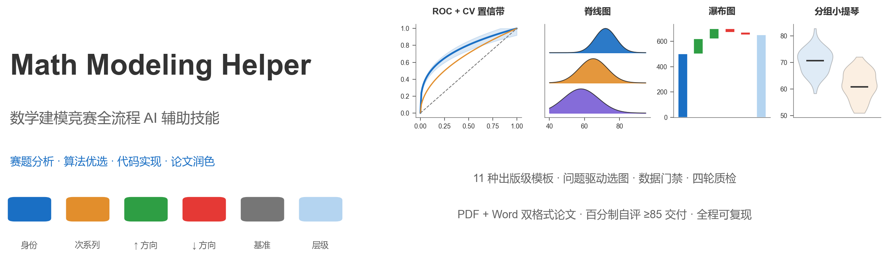
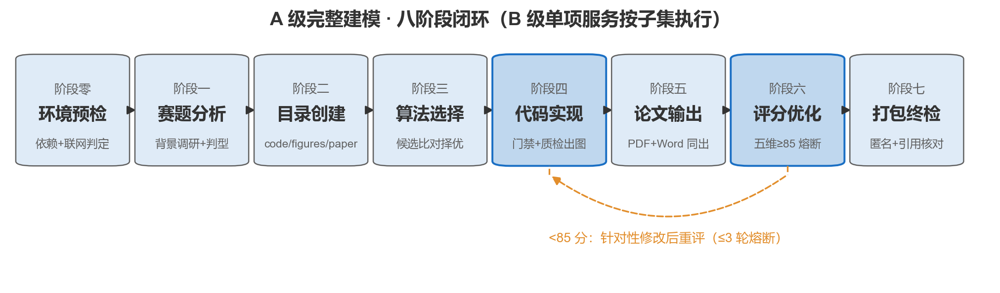
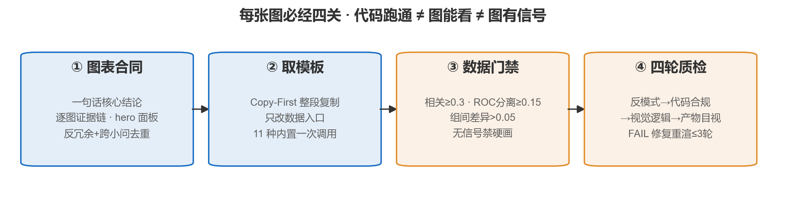
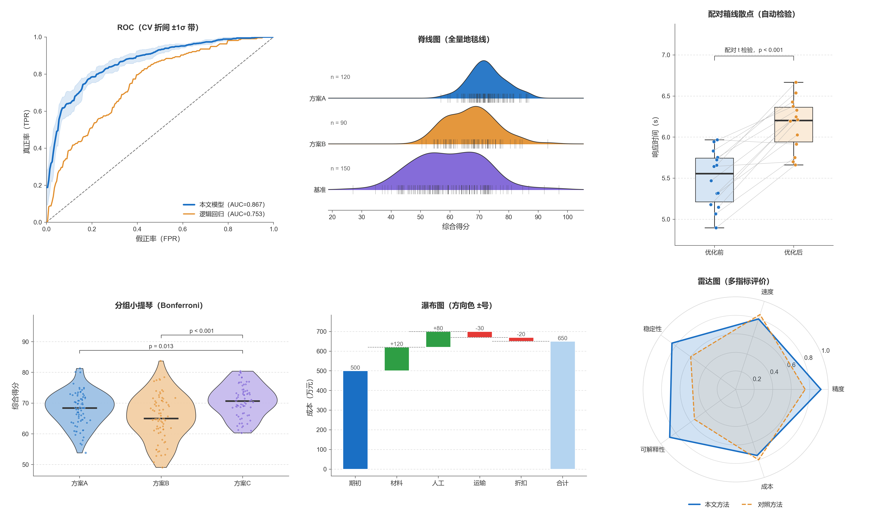

<div align="center">



# 数学建模竞赛辅助技能

**Math Modeling Helper · V3.3.0**

赛题分析 · 算法优选 · 代码实现 · 论文润色 —— 从赛题输入到论文定稿的一站式 AI 建模技能


**中文** | [English](https://github.com/Escap1ng/math-modeling-skill/blob/main/README.en.md)

[项目简介](#项目简介) · [核心亮点](#核心亮点) · [使用](#使用) · [快速开始](#快速开始) · [工作流程](#工作流程) · [环境依赖](#环境依赖) · [算法库](#算法库) · [论文与排版规范](#论文与排版规范) · [可视化规范](#可视化规范) · [评分体系](#评分体系) · [目录与文件](#目录与文件) · [更新日志](#更新日志) · [许可证](#许可证)

</div>

---

## 项目简介

面向数学建模竞赛的全流程 AI 辅助技能：**赛题理解 → 模型构建 → 算法实现 → 论文输出 → 质量自评**。技能本体是一份 Markdown（`SKILL.md`），复制即装；定稿一次给出 PDF 与 Word（公式为 Word 原生可编辑数学），不需人工二次排版。

> **适用赛事** —— 全国大学生数学建模竞赛（高教社杯 CUMCM）、美国大学生数学建模竞赛（MCM/ICM）、中国研究生数学建模竞赛（“华为杯”）、MathorCup 大学生数学建模挑战赛、全国大学生统计建模大赛、亚太地区大学生数学建模竞赛（APMCM）等；默认按国赛规范执行。

> **免责声明**：本工具生成的所有内容仅供学习参考，使用者须自行核实准确性，并严格遵守赛事学术诚信相关规定。论文排版以官方发布的最新规范为准。

---

## 核心亮点

| 亮点 | 说明 |
| :--- | :--- |
| 全流程自动化 | 八阶段（阶段零～七）一气呵成，细节见[工作流程](#工作流程) |
| 工作流分级 | 完整建模走全流程；算法咨询、单问代码、论文润色按单项服务只执行必要阶段，见[工作流程](#工作流程) |
| 单文件技能 | 整个技能就是一份 `SKILL.md` —— 无插件、无脚本，复制即用、可直接改 |
| 双格式论文交付 | PDF 与 Word 一次同出 —— 多数方案只给单一 Markdown 或仅 PDF |
| 精选算法库 | 高频 + 前沿方法速查，含时序基础模型与不确定性量化，见[算法库](#算法库) |
| 误用防护与基线 | 11 条算法误用红线 + 分题型最低基线清单 + 调参算力预算，见[算法库](#算法库) |
| 出版级可视化 | Nature 三色职责配色与统一样式模块，见[可视化规范](#可视化规范) |
| 获奖级排版规范 | 国赛获奖论文版式与匿名合规，见[论文与排版规范](#论文与排版规范) |
| 可回溯检索 | 背景、方法、开源实现与文献全程联网查证，交付检索记录与查证台账 |
| 质量闭环 | 百分制五维自评与熔断机制，见[评分体系](#评分体系) |
| 可复现交付 | 全局随机种子 + requirements.txt 版本锁定 + 打包前匿名终检与图片引用自动核对，见[工作流程](#工作流程) |

---

## 使用

把根目录的 `SKILL.md` 复制到所用 agent 的技能目录即可（各工具目录位置不同，以其文档为准；文件夹名须与 `SKILL.md` 头部的 `name: math-modeling-helper` 一致，例如 `~/.claude/skills/math-modeling-helper/SKILL.md`）。依赖清单见[环境依赖](#环境依赖)。

---

## 快速开始

技能装入 AI IDE 后，三步即可完成建模：

```
1. 上传赛题文件（PDF / Excel / CSV / TSV / TXT）或直接粘贴赛题内容
 ↓
2. 技能自动执行八阶段工作流（阶段零～七，见下文「工作流程」）
 ↓
3. 获取完整项目目录：code/ + figures/ + paper/（结构见下文「目录与文件」）
```

只需其中一环时，直接说明范围即按单项服务执行（不建目录、不出论文、不评分）：

| 说法示例 | 实际执行 |
| :--- | :--- |
| "问题二用什么算法合适？给个思路就行" | 联网查前沿 → 候选比对 → 输出选型结论与理由 |
| "只写问题一的代码，先不用出论文" | 只检该问所需库 → 只建 code/figures → 出可运行代码与图 |
| "帮我润色这份论文草稿，别改模型和数值" | 按写作规范修订 → 对照自检清单 → 交付修订稿并逐条说明改动 |

---

## 工作流程



先判级再执行：**A · 完整建模**（默认，赛题输入到论文定稿）走下列八阶段全流程（阶段零～七）；**B · 单项服务**（算法咨询 / 指定小问代码 / 论文润色）只执行对应阶段子集，不强制环境全检、建目录与论文评分（判级规则与子集见 SKILL.md「工作流分级」）。

```
阶段零 环境预检 → 阶段一 赛题分析 → 阶段二 目录创建 → 阶段三 算法选择
 ↓
最终输出 ← 阶段七 打包与匿名终检 ← 阶段六 评分 ≥ 85？ → 阶段五 论文输出 ← 阶段四 代码实现
 ↓ 未达标
 针对性修改 → 重新评分（≤ 3 轮）
```

| 阶段 | 工作内容 |
| :--- | :--- |
| 判级 · 服务分级 | A 完整建模走全流程；B 单项服务按子集执行（算法咨询 / 单问代码 / 润色）；意图不明默认 A，用户限定"只要 / 先只"按 B |
| 阶段零 · 环境预检 | 检查 xelatex / pandoc / Python 依赖与绘图库，判定联网检索能力档位，缺失项自动安装，输出环境状态报告 |
| 阶段一 · 赛题分析 | 联网调研题目背景与全网已有思考，判定问题类型（优化 / 预测 / 评价 / 分类 / 微分方程），梳理数据、约束与每问输出目标 |
| 阶段二 · 目录创建 | 按题建立 `answer/` 目录，统一 code / figures / paper 产出位置 |
| 阶段三 · 算法选择 | 每问生成 2–3 种候选，并联网补前沿方法与高水平论文，按精度、复杂度、鲁棒性、可解释性、实现可行性五维择优，拟合性优先于高级性 |
| 阶段四 · 代码实现 | 先查成熟库与高 star 开源实现（核许可证），再写完整可运行代码，numpy 向量化，出版级可视化统一走样式模块出图 |
| 阶段五 · 论文输出 | xelatex 生成 PDF，pandoc 生成 Word（公式转 OMML），双格式同步交付 |
| 阶段六 · 评分优化 | 百分制五维自评，未达标则针对性修改后重评（定稿门槛见[评分体系](#评分体系)） |
| 阶段七 · 打包与匿名终检 | 全文/文件名/图片/元数据匿名扫描，图片与论文引用双向核对，tmp 清理，重跑抽查可复现性，requirements.txt 与支撑材料 zip 打包交付 |

---

## 环境依赖

以下依赖在阶段零自动预检，缺失项将自动安装或给出安装指引。

| 依赖 | 用途 | 安装方式 |
| :--- | :--- | :--- |
| TeX Live / MiKTeX（xelatex） | 编译 LaTeX 生成 PDF | 官网安装 |
| pandoc | LaTeX → Word，公式自动转 OMML | `winget install pandoc` 或官网下载 |
| Python 3.8+ | 数值计算、机器学习与绘图 | 官网安装 |
| python-docx / PyMuPDF / openpyxl / xlrd | Word 版式微调、PDF 与 Excel 数据读取 | `pip install python-docx pymupdf openpyxl xlrd` |
| numpy / pandas / scipy / matplotlib / seaborn | 数值计算、优化求解与绘图 | `pip install` |
| pulp / cvxpy / scikit-learn / xgboost / networkx / statsmodels | 规划建模、机器学习、图论、统计推断（按题选用） | `pip install` |
| graphviz / kaleido | 复杂架构图 / plotly 静态导出（可选） | 按需安装 |

一键安装 Python 依赖（`xelatex` 与 `pandoc` 为系统级安装，见上表）：

```bash
pip install numpy pandas scipy matplotlib seaborn openpyxl xlrd python-docx pymupdf pulp cvxpy scikit-learn xgboost networkx statsmodels
```

自检缺哪些包（全部可用则无输出）：

```bash
python -c "import importlib.util as u; [print('MISSING:', m) for m in ['numpy','pandas','scipy','matplotlib','seaborn','openpyxl','xlrd','docx','fitz'] if u.find_spec(m) is None]"
```

按题需要另装：`lightgbm`（梯度提升树）、`ortools`（组合优化 / 指派）、`pymoo`（NSGA-II/III）、`prophet`（时间序列）、`PyWavelets`（小波，导入名 `pywt`）、`timesfm[torch]`（时序基础模型 TimesFM 3，Python≥3.10，权重非商业许可）、`shap`（模型解释）、`geopandas` / `folium`（地理空间与地图）、`adjustText`（标注避让）；另有 `optuna`（超参搜索）、`catboost`、`lmfit`（带界拟合）、`lifelines`（生存分析）、`filterpy`（卡尔曼）、`EMD-signal`（EMD，导入名 `PyEMD`）、`simpy` / `mesa`（仿真）、`esda` / `pykrige`（空间统计）、`jieba`（分词）、`gplearn` / `pysr`（符号回归，PySR 需 Julia）、`dowhy` / `econml`（因果推断）、`torch` / `deepxde` / `stable-baselines3`+`gymnasium` / `torch-geometric`（深度学习、PINN、强化学习、图网络）按需另装。

阶段零同时探测联网检索能力（能否按关键词搜索、能否取回指定 URL 正文），按「可用 / 部分可用 / 不可用」三档写入环境状态报告；不可用时按降级规则执行，不得凭记忆补全文献。

---

## 算法库

| 分类 | 代表方法 |
| :--- | :--- |
| 基础数值方法 | 二分法、牛顿迭代法、梯度下降、共轭梯度、单纯形法、内点法<br>梯形 / 辛普森积分、高斯消元、LU 分解、最小二乘拟合<br>拉格朗日 / 牛顿 / 三次样条插值 |
| 经典优化方法 | 0-1 整数规划、非线性规划、动态规划、分支定界、线性规划（LP）、匈牙利算法<br>目标规划、运输问题、二次规划、拉格朗日松弛<br>博弈论（零和博弈、纳什均衡、演化博弈） |
| 启发式优化 | 遗传算法（GA）、模拟退火（SA）、粒子群优化（PSO）、禁忌搜索（TS） |
| 图论与网络优化 | 最短路径（Dijkstra / Floyd / Bellman-Ford）、最小生成树（Prim / Kruskal）、最大流、最小费用最大流<br>TSP / VRP、二分图匹配、拓扑排序、关键路径法（CPM / PERT）、欧拉 / 哈密顿回路 |
| 群体智能算法 | 差分进化（DE）、蚁群算法（ACO）、灰狼优化（GWO）、鲸鱼优化（WOA）、人工蜂群（ABC）<br>麻雀搜索（SSA）、蜣螂优化（DBO）、金豺优化（GJO）、白鲸优化（BWO） |
| 机器学习与深度学习 | XGBoost、SVM、随机森林、LightGBM、CatBoost、KNN<br>Transformer、CNN、RNN / LSTM、自编码器（AE / VAE）、注意力机制<br>强化学习：DQN、PPO、SAC、TD3 |
| 统计与数据分析 | 假设检验（Z / t / 卡方、ANOVA、Shapiro-Wilk）、相关性（Spearman / Kendall）<br>回归插值（响应面法 RSM、高斯过程回归 GPR、岭回归 / Lasso、多项式 / 逐步回归）<br>降维聚类（PCA、t-SNE、UMAP、K-means / DBSCAN、层次聚类、GMM）<br>时间序列（ARIMA、LSTM / GRU、Prophet、Holt-Winters、VAR）<br>小样本预测（灰色预测 GM(1,1)、马尔可夫链、组合预测）<br>分类判别（Fisher 判别、逻辑回归、朴素贝叶斯、决策树）<br>统计推断（极大似然估计 MLE、EM 算法、贝叶斯估计） |
| 异常检测与不确定性 | 3σ / IQR 判据、孤立森林、LOF、DBSCAN 噪声点<br>Bootstrap 置信区间（BCa）、分位数回归与区间预测（须报经验覆盖率）、蒙特卡洛误差传播 |
| 参数反演与生存分析 | 非线性最小二乘（LM / 信赖域）、带界约束拟合与参数置信区间、可辨识性分析<br>Kaplan–Meier 生存曲线、Cox 比例风险模型（含删失数据） |
| 文本与空间分析 | 中文分词 + TF-IDF、LDA 主题模型、文本分类与情感词典<br>Moran's I / LISA 空间自相关、克里金插值、空间权重矩阵与空间回归 |
| 超参搜索 | 网格 / 随机搜索、TPE 与贝叶斯优化、早停剪枝（须先定试验预算） |
| 综合评价与决策 | TOPSIS（熵权-TOPSIS 首选）、熵权法、CRITIC 权重法、层次分析法（AHP）<br>灰色关联分析、模糊综合评价、数据包络分析（DEA）<br>期望值决策法、决策树分析、成本效益分析 |
| 物理与工程建模 | 运动学、拉格朗日力学、有限元分析、刚体动力学<br>微分方程数值解（欧拉法、RK4、有限差分、SIR / SEIR、稳定性分析）<br>蒙特卡洛仿真、离散事件仿真 DES、元胞自动机、多智能体仿真 ABM、排队论 |
| 信号处理 | FFT、小波变换、经验模态分解 EMD、卡尔曼滤波、希尔伯特-黄变换（HHT） |
| 前沿创新方法 | 物理信息神经网络 PINN、算子学习（DeepONet / FNO）、数字孪生<br>符号回归、可解释 AI（SHAP / LIME）、因果推断（双重差分 DID、因果图）<br>多目标优化（NSGA-II / III、MOEA/D）、鲁棒 / 贝叶斯优化、GNN / GAT、社区发现（Louvain） |
| 时序基础模型 | TimesFM 3.0（零样本、原生多变量 + 协变量 + 分位数；权重非商业许可，2.5 权重 Apache-2.0 可回退）<br>同类备选 Chronos-2、Moirai 2.0（选用前核对权重许可与能力边界） |

### 选型防护：误用红线与基线对照

算法库解决"有什么可用"，以下三条纪律解决"别用错、别自说自话"，均已接入自检清单与评分细则。

**算法误用红线（11 条，选型时逐条自查，命中即换方案）**

| 类别 | 典型红线 |
| :--- | :--- |
| 容量与数据不匹配 | 小样本上深度学习 / 强化学习；高成本方法未过可行性验证即作主模型 |
| 降维与切分误用 | 在 t-SNE / UMAP 坐标上做聚类或回归（仅可可视化）；时序随机切分造成信息泄漏 |
| 检验缺失 | AHP 不报一致性 CR；GM(1,1) 不做级比与后验差检验；K-means 无 k 的选取依据 |
| 口径错误 | 熵权 / CRITIC 未统一指标方向；类别不平衡只报 accuracy；区间预测不报经验覆盖率 |
| 因果误断 | 相关性显著写成"导致 / 驱动"，无识别策略与反驳检验 |

**分题型最低基线**（缺基线的提升百分比一律不成立）

| 题型 | 必备基线 |
| :--- | :--- |
| 预测 | naive（末值延续）+ 季节性 naive，另加 ARIMA / 指数平滑或 GM(1,1) |
| 优化 | 贪心 / 规则可行解 + LP 松弛或精确法下界，并报告最优性间隙 |
| 分类 | 多数类基线 + 逻辑回归（不平衡时禁只报 accuracy） |
| 评价排序 | 等权 TOPSIS + 一种替代赋权，比秩相关与权重扰动稳定性 |
| 微分方程 | 解析解或极限情形 + 更细步长解，比守恒量偏差与收敛阶 |
| 聚类 / 异常 | 给定 k 的 K-means + 随机标签基线；异常须给已知样本召回 |

**调参与算力预算** —— 高成本方法（强化学习 / PINN / 深度学习 / 时序基础模型）先小规模验证收敛性、耗时与是否优于基线，再投全量；超参搜索须先定试验上限与早停规则；失败按"换等价实现 → 退化轻量方法"处理并记录退化路径，不得静默换算法。

---

## 论文与排版规范

- **匿名一票否决** —— 全文任何位置（含页眉页脚、图片、代码注释、文件名）禁止出现姓名、学校、赛区、队号、指导教师，页眉必须留空
- **双格式交付** —— `.tex` 源文件 + `.pdf` 成品 + `.docx` Word（pandoc 转换，公式为 OMML 原生数学格式，可在公式编辑器中编辑）
- **页面设置** —— A4 纸、四边 2.5cm 页边距；中文正文宋体小四、西文与数字 Times New Roman；页码页尾居中，摘要页即第 1 页
- **结构规范** —— 题目、摘要（800–1000 字、含具体数值与误差分析）、关键词三者同页；模型假设强制三线表（4–6 条，含合理性说明）；全文表格禁止竖线
- **公式规范** —— 核心公式（目标函数 / 关键约束 / 状态方程）独立编号并在正文引用；推导从简；检测量公式（R²/MAE/RMSE/MAPE）全文仅首次定义一次
- **正文表述** —— 问题—回应结构，每问结尾给出明确结论段；问题间强制承上启下；去 AI 化自查（禁模板腔开头、套话升华、过渡词滥用）
- **参考文献** —— GB/T 7714 格式，5–8 篇，至少 2 篇近 5 年文献、1 篇英文文献；每条须经外部检索逐字段核验，查不到即放弃引用，查证台账随交付一并给出

---

## 可视化规范





- **问题驱动选图** —— 画图前先立图表合同（一句话核心结论 + 逐图证据链 + hero 面板），过反冗余审计（同数据两画法 / 子集重复 / 可互相推导即合并），图数由独立子问题数决定；方法内化自 academic-figure-skill（Apache-2.0）
- **数据门禁与四轮质检** —— 渲染前逐图校验信号强度（相关 ≥0.3、ROC 分离度 ≥0.15、组间差异等），不通过禁止硬画；渲染后按反模式 → 代码合规 → 视觉逻辑 → 产物目视四轮质检，FAIL 修复重渲
- **出版级质量** —— 分辨率 ≥300 DPI（密度类图可降至 200），线条 / 柱状类优先矢量 PDF
- **Nature 三色职责配色** —— 颜色只承担身份（主角蓝打头）、方向（红绿仅表增减并带 ↑/↓）、层级（`TONE_RAMP` 明度）三种职责，基准恒为灰；禁 jet / rainbow / 纯黑 / 脚本内硬编码色值，灰度打印仍可辨
- **图表数量** —— 每小问至少 1 张彩色图，全文建议 6 张以上、保底 4 张；第二章强制插入问题分析流程图 / 技术路线图
- **统一样式模块** —— 色板、色图、纹理、三档尺寸、分级字号与样式助手（`style_axes` / `annotate_bars` / `delta_annotation` 等）单点定义于 `plot_style.py`，正式图与预览图同品质
- **图库不是边界** —— 图型随数据结构与要论证的结论选，模板库外可自由创新现绘；但样式零自由：全文一律共用同一套常量与「先登记方法-颜色对照」的跨图统一契约
- **英文赛就绪** —— 美赛 / 全英文场景标注细则内置（Quantity (unit) 轴标签、结论式图题、英文统计标注、长标签防溢出）；半栏紧凑尺寸 `FIG_HALF` 供并排小图；色卡精修：发散色图中点近白、顺序系三段蓝，黑白打印层次更清
- **高频模板内置** —— 三维曲面（定比三维框 + 独立 colorbar）、拟合对比（置信带 + 残差子图）、迭代收敛曲线、问题分析流程图（内容 dict 驱动 + 自动正交连线 + 标准箭头图元 + 字宽门禁）；热力图、Pareto 前沿、龙卷风、雷达、甘特、ROC（含 CV 折间置信带）、脊线图、配对箱线散点、边际密度散点、瀑布图、分组小提琴（Mann-Whitney + Bonferroni + 防重叠括号）十一种简单图型内置 `plot_templates.py` 一次调用函数（五种继承 academic-figure-skill 生产脚本视觉参数与统计逻辑并实测出图通过）；泰勒图、云雨图、SHAP 组合等进阶图型另可套 `mathmodel-figure` 的同名模板作补充

---

## 评分体系

| 维度 | 分值 | 评分依据 |
| :--- | :--- | :--- |
| 摘要 | 30 | 结构完整性、数值具体性、递进关系、与正文一致性 |
| 算法 / 模型正确性 | 20 | 数学推导无误、约束完备、求解结果合理、参数依据可回溯 |
| 创新性 | 20 | 方法创新度、跨学科融合、自定义指标构建、以先验调研为据 |
| 写作能力 | 15 | 逻辑连贯、学术语态、数据支撑、无空泛表达与 AI 痕迹、事实陈述有来源 |
| 排版 | 15 | 格式规范、图表完整、符号一致、匿名合规（违反一票否决）、著录格式合规 |
| **合计** | **100** | **≥ 85 分方可最终输出** |

未达标时列出扣分项、针对性修改后重新评分，最多优化 3 轮；3 轮后仍未达标则输出当前版本并标注「需人工复核」，熔断机制防止无限循环。

---

## 目录与文件

**建模产出目录**

```
第X题_赛题简称/
└── answer/
    ├── requirements.txt  # 依赖版本清单（阶段四生成，随阶段七打包交付）
    ├── code/       # Python 代码（q1_*.py、q2_*.py，含 plot_style.py 样式模块 + plot_templates.py 简单图型函数）
    ├── figures/
    │   ├── final/  # 交付图（语义命名，须被论文引用）
    │   └── tmp/    # 调试图（与正式版同品质，交付前整体删除）
    └── paper/      # paper.tex + paper.pdf + paper.docx
```

**仓库文件**

| 文件 | 说明 |
| :--- | :--- |
| `SKILL.md` | 技能核心：工作流分级与八阶段流程（阶段零～七）、算法库与误用红线、基线对照与算力预算、代码模板、论文写作与正文语言规范、可视化与排版规范、联网检索与参考文献查证、论文质量自检与百分制评分体系 |
| `README.md` | 中文说明文档（本文件） |
| `README.en.md` | 英文说明文档 |
| `assets/` | README 配图：标题图、八阶段工作流、出图四关、模板画廊（技能样式模块生成） |
| `LICENSE` | MIT 许可证 |

---

## 更新日志

### V3.3.0

**新增（融合 academic-figure-skill，Apache-2.0，方法内化 + 精选模板）**

- **选图论证与反冗余审计**：画图前强制立图表合同（一句话核心结论 / 逐图证据链 / hero 面板主次），五类冗余陷阱逐对排查，图数由独立子问题数决定；取模板 Copy-First——命中即整段复制只改数据入口，外部图型按硬/比例/逻辑三类参数继承且配色一律换本 skill 语义色板
- **渲染前数据门禁**：七类图型的信号强度阈值（相关 ≥0.3、ROC 分离度 ≥0.15、组间差异 >0.05 等），不通过先修根因或如实报告，禁止调参造信号；全量数据铁律（渲染压力用栅格化解决，不降采样）
- **出图后四轮质检**：反模式扫描 → 代码合规 → 视觉逻辑 → 渲染产物目视（含面板内容密度 1.5%–50% 检查），FAIL 修复重渲最多 3 轮
- **四种竞赛高频模板**：`plot_templates.py` 新增 ROC（AUC 现算入图例 + 门禁告警）、脊线图（ggridges 层叠口径 + 全量地毯线 + n 标注）、配对箱线散点（个体连线 + 自动选检验 + 精确 p 值括号，返回统计摘要）、边际密度散点（分组 KDE + r/p 标注，返回相关性摘要）；视觉参数继承上游生产脚本，配色字号换算到 `plot_style.py` 契约，已实测出图通过
- 自检清单图表类新增 5 条对应检查项；阶段四出图流程挂接"合同 → 门禁 → 质检"三关

- **竞赛向精修（保持精简）**：色卡更新——发散色图中点由浅灰改近白（零点更干净、黑白打印明度对称）、顺序色图改三段蓝（低值段层次更清）；新增 `FIG_HALF` 半栏紧凑尺寸与英文赛标注细则（美赛/全英文场景：Quantity (unit) 轴标签、结论式图题、英文统计标注、长标签防溢出）；反冗余审计升级为**跨小问去重**（同数据同画法全文只保留一次，交付前逐对目视比对）；新增瀑布图模板 `waterfall`（成本/收益累计分解，方向色带 +/− 号冗余编码）
- **README 视觉升级**：新增 `assets/` 四张配图（标题图含三职责色卡与真实模板缩样、八阶段闭环工作流、出图四关解释图、六宫格模板画廊），全部由技能自带样式模块生成，与出图同一视觉体系
- **重复模板对比择优**：与上游仓库十类重叠图型逐一对比——雷达/热图/分组柱状/趋势线保留本 skill 版（上游版存在 p 值硬编码、柱位重叠、LaTeX 依赖、无中文支持等问题）；桑基上游脚本缺自制依赖包不可运行，不吸收；ROC 增强为支持 CV 折间均值 ±1σ 置信带并自动补曲线端点（上游三版均无此能力）；新增分组小提琴 `violin_groups`（吸收上游 Mann-Whitney + Bonferroni 校正与括号防重叠抬升算法，散点种子统一）

> **边界说明**：本次采纳上游的选图流程与部分图型绘制方法，全部按竞赛场景择优内化；期刊栏宽与投稿专用色板未引入，英文标注细则与色卡精修服务于美赛等英文赛事，竞赛排版与 Nature 三职责配色仍是唯一出处。

### V3.2.0

**新增**

- **工作流分级**：A 完整建模走全流程；B 单项服务（算法咨询 / 指定小问代码 / 论文润色）只执行必要阶段，轻量请求不再被迫走环境全检与论文评分
- **阶段七 · 打包与匿名终检**：匿名扫描扩至文件名、代码注释、图片水印与文档元数据；图片与 `.tex` 引用双向自动核对；可复现性抽查；支撑材料 zip 与运行说明
- **可复现交付**：全局随机种子（`plot_style.SEED` 唯一出处）+ `requirements.txt` 版本锁定
- **绘图函数化**：`plot_templates.py` 一次调用出图，含热力图、Pareto 前沿与新增的龙卷风、雷达、甘特三种图型
- **时序基础模型**：TimesFM 3.0（多变量 / 协变量 / 分位数零样本），附 2.5 的 Apache-2.0 权重回退接口与非商业许可提示
- **算法库补 7 类**：异常检测、不确定性量化、参数反演与拟合、生存分析、文本挖掘、空间统计、超参搜索
- **三项选型纪律**：算法误用红线 11 条、分题型最低基线清单、调参与算力预算（含失败退化链）
- **速查表补齐**：实现速查 +19 类、选择速查 +9 类问题入口，消除"库里有方法但查不到实现 / 无选型入口"的断点

**修正**

- 依赖名纠错：`python-ortools` → `ortools`；安装名 `pywt` → `PyWavelets`（导入名仍为 `pywt`）
- 数据读取补 `.xlsm / .csv / .tsv / .txt`，自动识别 UTF-8(BOM) / GBK 与三种分隔符，纯文本 TXT 回退原文
- Word 后处理对齐排版规范：中西文字体分离（西文 Times New Roman）、补二三级标题与图表标题样式、表格改首列居中其余左对齐
- 条形数值标注端点改为"起点 + 宽/高"，修复非零基线（如龙卷风基准线）标注错位

**精简**

- 删除可快速写出的示例代码与两个简单图型模板，合并重复的摘要模板、评价规范与负面清单
- 流程图模板改用标准箭头图元，移除手写三角几何与冗余辅助函数

> **行为变化**：Word 字体与表格对齐由"违反自身规范"改为合规、随机种子统一、新增阶段七终检门槛——均为补齐与加严，非功能删减。TimesFM 3.0 权重限非商业用途（竞赛属此），转商用须换 2.5 权重或走官方授权服务。

### V3.1.0

首个公开版本：七阶段全流程、双格式论文交付、Nature 三色可视化规范、国赛获奖级排版与百分制五维评分体系。

---

## 许可证

MIT License © 2026 Escap1ng
